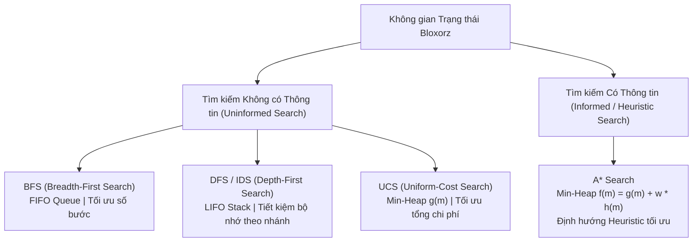
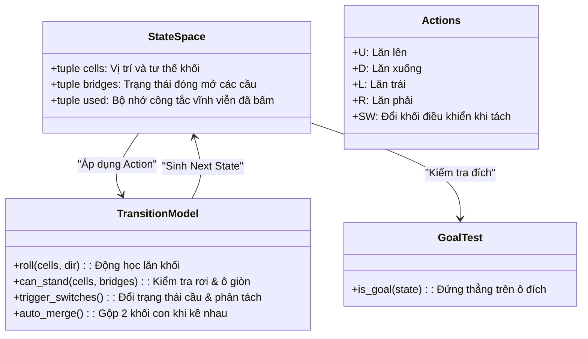

# BÁO CÁO KỸ THUẬT VÀ THỰC NGHIỆM: CÁC THUẬT TOÁN TÌM KIẾM TRONG ĐỒ ÁN BLOXORZ AI

Tài liệu này trình bày chi tiết về phần mô tả thuật toán (**Algorithm Description**) và kết quả thực nghiệm đối chuẩn (**Experiments**) của 4 thuật toán tìm kiếm: **BFS**, **DFS/IDS**, **UCS**, và **A\*** trong đồ án Bloxorz AI.

---

# PHẦN 1: MÔ TẢ THUẬT TOÁN (ALGORITHM DESCRIPTION)

## 1.1. Chi tiết các Thuật toán Tìm kiếm (Detailed Explanations of Search Algorithms)

Hệ thống triển khai 4 thuật toán tìm kiếm trên không gian trạng thái của trò chơi Bloxorz:

---

### 1. Breadth-First Search (BFS)
* **Nguyên lý hoạt động**:
  * BFS duyệt không gian trạng thái theo từng tầng độ sâu (level-by-level), sử dụng hàng đợi hai đầu FIFO `collections.deque` (`solver/bfs.py`). Tất cả các node ở độ sâu $d$ đều được khám phá hết trước khi bất kỳ node nào ở độ sâu $d+1$ được xét tới.
  * Vì mọi hành động hợp lệ trong cấu hình đồng nhất đều có chi phí bằng $1$, lần đầu tiên một đường đi chạm tới trạng thái đích thì độ dài đường đi đó chắc chắn là số bước ít nhất có thể ($d^*$).
* **Cơ chế kiểm tra đích sớm (Early Goal Test - On Generation)**:
  * Khác với các thuật toán dựa trên chi phí đường đi như UCS hay A\*, BFS với chi phí đồng nhất kiểm tra `level.is_goal(next_state)` **ngay khi trạng thái con vừa được sinh ra** (on generation) thay vì đợi đến khi node được lấy ra khỏi hàng đợi (on expansion).
  * *Lợi ích*: Cơ chế này giúp thuật toán kết thúc ngay tại thời điểm chạm đích ở tầng $d^*$, tiết kiệm việc phải mở rộng toàn bộ các node còn lại ở tầng $d^*-1$ và không phải nạp thêm hàng ngàn node của tầng $d^*+1$ vào bộ nhớ.
* **Cách thức triển khai trong mã nguồn (`solver/bfs.py`)**:
  1. Khởi tạo hàng đợi biên: `frontier = deque([start])`.
  2. Khởi tạo cấu trúc theo dõi: `parent = {start: None}`. Cấu trúc dictionary này đóng vai trò "2 trong 1":
     - Vừa là tập `visited` (closed) để kiểm tra trạng thái đã duyệt với độ phức tạp $O(1)$.
     - Vừa lưu vết cặp `(parent_state, action)` phục vụ hàm `_reconstruct_path(...)` truy vết ngược từ đích về xuất phát khi tìm thấy nghiệm.
  3. Vòng lặp chính:
     - Rút trạng thái từ đầu hàng đợi: `state = frontier.popleft()`, tăng bộ đếm `expanded += 1`.
     - Sinh các trạng thái kế tiếp qua `level.get_next_states(state, UNIFORM)`.
     - Duyệt các nhánh con theo thứ tự ưu tiên chuẩn định trước: `BFS_ORDER = ("U", "D", "R", "L", "SW")`.
     - Bỏ qua các `next_state` đã tồn tại trong `parent`.
     - **Kiểm tra đích ngay lập tức**: Nếu `level.is_goal(next_state)` là `True`, lập tức gọi `_reconstruct_path(parent, next_state)` và trả về nghiệm `(actions, path, expanded)`.
     - Nếu chưa phải đích, ghi nhận `parent[next_state] = (state, action)` và đẩy vào đuôi hàng đợi `frontier.append(next_state)`.
* **Tính chất**:
  * **Tính đầy đủ (Completeness)**: Đầy đủ $100\%$ trên không gian trạng thái hữu hạn của Bloxorz.
  * **Tính tối ưu (Optimality)**: Tối ưu tuyệt đối về số bước đi khi chi phí mỗi bước là đồng nhất ($c = 1$).
  * **Độ phức tạp**: Thời gian $O(b^d)$, Bộ nhớ $O(b^d)$ (với $b$ là hệ số nhánh trung bình, $d$ là độ sâu nghiệm).

---

### 2. Depth-First Search (DFS) và Iterative Deepening Search (IDS)
* **Nguyên lý hoạt động của DFS**:
  * DFS khám phá không gian trạng thái theo chiều sâu tối đa trước khi quay lui (backtracking), sử dụng ngăn xếp LIFO `list` với các thao tác `append()` và `pop()` (`solver/dfs.py`). Khi ở một trạng thái, thuật toán tiếp tục đào sâu dọc theo một nhánh hành động cho đến khi gặp trạng thái ngõ cụt hoặc tìm thấy đích.
  * **Cơ chế kiểm tra đích (Goal Test on Expansion)**: DFS kiểm tra trạng thái đích khi node được lấy ra khỏi ngăn xếp (`if level.is_goal(state)`).
  * **Cơ chế Graph Search với `visited set`**: Trong không gian trạng thái của Bloxorz tồn tại vô số chu trình (ví dụ: lăn U rồi lăn D sẽ quay lại trạng thái ban đầu). Do đó, DFS bắt buộc phải duy trì một tập `visited = set()` để ngăn chặn việc rơi vào vòng lặp vô tận.
* **Cách thức triển khai trong mã nguồn (`solver/dfs.py`)**:
  1. Khởi tạo: `stack = [start]`, `visited = {start}`, `parent = {start: None}`.
  2. Vòng lặp chính `while stack:`:
     - Lấy trạng thái đỉnh ngăn xếp: `state = stack.pop()`.
     - Kiểm tra đích: Nếu `level.is_goal(state)` đạt điều kiện, gọi `_reconstruct_path(parent, state)` và trả về nghiệm.
     - Tăng số node mở rộng: `expanded += 1`.
     - Sinh các trạng thái kế tiếp qua `level.get_next_states(state, UNIFORM)`.
     - **Thứ tự ưu tiên nhánh duyệt**: Thuật toán duyệt các hành động kế tiếp theo thứ tự đảo ngược `reversed(DFS_ORDER)` (`SW -> L -> R -> D -> U`) khi đẩy vào stack. Nhờ nguyên lý LIFO, hành động đứng đầu trong `DFS_ORDER = ("U", "D", "R", "L", "SW")` sẽ nằm ở đỉnh stack và được `pop()` ra mở rộng trước tiên.
     - Nếu `next_state not in visited`: đánh dấu `visited.add(next_state)`, lưu vết `parent[next_state] = (state, action)` và đẩy vào `stack.append(next_state)`.
* **Tính chất của DFS**:
  * **Tính đầy đủ (Completeness)**: Đầy đủ trên không gian trạng thái hữu hạn nhờ có `visited set`.
  * **Tính tối ưu (Optimality)**: **Hoàn toàn không tối ưu**. DFS có xu hướng đi sâu mù quáng vào các nhánh đường vòng cực dài (ví dụ: Level 15 nghiệm tối ưu chỉ 8 bước, nhưng DFS đi mất 121 bước — gấp 15 lần).
* **Nêu rõ Thực tế Triển khai và Mở rộng với Iterative Deepening Search (IDS)**:
  * **Thực tế trong đồ án**: Dự án triển khai **DFS đồ thị (Graph-Search DFS)** trong file `solver/dfs.py`. Việc giữ nguyên DFS truyền thống nhằm phục vụ mục đích thực nghiệm đối chứng trong báo cáo — cho thấy rõ sự đánh đổi và nhược điểm nghiêm trọng về tính tối ưu của tìm kiếm theo chiều sâu so với tìm kiếm theo chiều rộng và tìm kiếm có thông tin.
  * **Phân tích mở rộng IDS (Iterative Deepening Search)**:
    * Nếu bài toán yêu cầu khắc phục nhược điểm không tối ưu của DFS mà vẫn tiết kiệm bộ nhớ, thuật toán **IDS** là giải pháp thay thế hoàn hảo.
    * *Nguyên lý IDS*: IDS lặp lại thuật toán Depth-Limited Search (DLS) với giới hạn độ sâu tăng dần $l = 0, 1, 2, \dots, d^*$. Ở mỗi lượt $l$, IDS duyệt theo chiều sâu nhưng cắt tỉa mọi nhánh vượt quá độ sâu $l$.
    * *Ưu điểm vượt trội của IDS*:
      1. **Đạt tính tối ưu số bước tuyệt đối** như BFS: Lần đầu tiên tìm thấy nghiệm ở độ sâu $l = d^*$, đường đi chắc chắn ngắn nhất.
      2. **Tiết kiệm bộ nhớ vượt bậc** như DFS: Bộ nhớ chỉ tỷ lệ thuận tuyến tính theo độ sâu $O(b \cdot d^*)$, giải quyết triệt để vấn đề bùng nổ bộ nhớ $O(b^{d^*})$ của BFS.
      3. Chi phí duyệt lại các tầng trước chỉ chiếm một tỷ lệ nhỏ $\frac{b}{b - 1}$ tổng thời gian chạy, hoàn toàn chấp nhận được so với lợi ích bộ nhớ mang lại.

---

### 3. Uniform Cost Search (UCS)
* **Nguyên lý hoạt động**:
  * UCS là thuật toán tìm kiếm không có thông tin tối ưu trên đồ thị có trọng số cạnh, mở rộng trạng thái dựa trên tổng chi phí tích luỹ $g(m)$ từ điểm xuất phát.
  * Sử dụng cấu trúc hàng đợi ưu tiên Min-Heap (`heapq` trong `solver/ucs.py`). Trạng thái có chi phí $g(m)$ thấp nhất trên biên tìm kiếm (frontier) luôn được ưu tiên lấy ra mở rộng trước.
* **Cơ chế kiểm tra đích (Goal Test on Expansion)**:
  * Bắt buộc phải kiểm tra điều kiện đích **tại thời điểm lấy trạng thái ra khỏi hàng đợi (`heappop`)**, tuyệt đối không được kiểm tra khi sinh node (on generation).
  * *Lý do*: Một trạng thái đích có thể được sinh ra sớm thông qua một đường đi có chi phí $g$ cao; nếu dừng ngay lập tức thì thuật toán sẽ bỏ lỡ một đường đi khác đến đích được tìm thấy sau nhưng có chi phí tích luỹ $g$ thấp hơn.
* **Cách thức triển khai trong mã nguồn (`solver/ucs.py`)**:
  1. Khởi tạo Min-Heap: `frontier = [(0, counter, start)]`. Trong đó tuple lưu trữ gồm:
     - `g`: Chi phí đường đi tích luỹ từ điểm xuất phát (tiêu chí ưu tiên chính).
     - `counter`: Số nguyên tăng dần tự động đóng vai trò **tie-breaker thứ cấp**, giúp heap so sánh ổn định mà không cần nạp hàm so sánh phức tạp cho đối tượng trạng thái `state`.
     - `state`: Trạng thái Bloxorz `(cells, bridges, used)`.
  2. Bảng theo dõi chi phí: `best_g = {start: 0}` lưu chi phí nhỏ nhất từng biết tới mỗi trạng thái.
  3. Bảng truy vết: `parent = {start: None}`.
  4. Tập đóng: `closed = set()` lưu các trạng thái đã hoàn tất mở rộng.
  5. Vòng lặp chính:
     - Lấy phần tử rẻ nhất: `g, _, state = heapq.heappop(frontier)`.
     - Nếu `state in closed`: bỏ qua (do một trạng thái có thể được push vào heap nhiều lần với các mức chi phí $g$ khác nhau, chỉ xử lý lần lấy ra có $g$ nhỏ nhất đầu tiên).
     - **Kiểm tra đích**: Nếu `level.is_goal(state)` là `True`, gọi `build_result(...)` tái tạo đường đi và trả về kết quả.
     - Đánh dấu đã duyệt: `closed.add(state)`, tăng `expanded += 1`.
     - Duyệt qua các trạng thái kế tiếp: `for action, next_state, cost in level.get_next_states(state, cost_model):`
       - Tính chi phí tích luỹ mới: `new_g = g + cost`.
       - Nếu `next_state in closed`: bỏ qua.
       - Nếu `next_state not in best_g` hoặc `new_g < best_g[next_state]`:
         - Cập nhật chi phí tốt nhất: `best_g[next_state] = new_g`.
         - Cập nhật vết: `parent[next_state] = (state, action)`.
         - Tăng `counter += 1`.
         - Đẩy vào hàng đợi ưu tiên: `heapq.heappush(frontier, (new_g, counter, next_state))`.
* **Tính chất**:
  * **Tính đầy đủ & Tối ưu toàn cục**: Đảm bảo $100\%$ khi chi phí mỗi bước đi thỏa mãn điều kiện $c(m, a, m') \ge \epsilon > 0$.
  * **Độ phức tạp**: Thời gian và bộ nhớ $O(b^{1 + \lfloor C^* / \epsilon \rfloor})$ (với $C^*$ là chi phí tối ưu, $\epsilon$ là chi phí bước đi nhỏ nhất).

---

### 4. A* Search
* **Nguyên lý hoạt động**:
  * A\* là thuật toán tìm kiếm có thông tin (informed search) kết hợp chi phí thực tế đã đi $g(m)$ với hàm heuristic ước lượng chi phí còn lại tới đích $h(m)$ thông qua hàm đánh giá tổng thể (`solver/a_star.py`):
    $$f(m) = g(m) + w \cdot h(m) \quad (w = 1.0 \text{ cho A* chuẩn})$$
  * Node có giá trị $f(m)$ nhỏ nhất trong hàng đợi ưu tiên Min-Heap luôn được chọn mở rộng trước.
  * *Ưu thế định hướng*: Trong khi BFS và UCS mở rộng đều theo mọi hướng tạo thành hình cầu đẳng hướng trong không gian trạng thái, A\* sử dụng giá trị $h(m)$ như một lực định hướng kéo không gian tìm kiếm tập trung về phía ô đích, cắt tỉa triệt để các nhánh đi xa mục tiêu.
* **Cơ chế Tie-Breaking trong Priority Queue (`solver/a_star.py`)**:
  * Trong trò chơi Bloxorz, có rất nhiều trạng thái cùng tầng có giá trị hàm đánh giá $f(m)$ bằng nhau. Nếu bốc ngẫu nhiên, A\* sẽ bị phân vân và mở rộng lan man nhiều node không cần thiết.
  * Thuật toán triển khai cơ chế **Tie-Breaking theo chiều sâu**: Mỗi phần tử trong heap được lưu dưới dạng tuple 4 thành phần:
    $$\text{item} = (f(m), \; -g(m), \; \text{counter}, \; \text{state})$$
  * Khi hai node có cùng giá trị $f(m)$, Python heap sẽ so sánh phần tử thứ hai: phần tử có $-g(m)$ nhỏ hơn (tức $g(m)$ lớn hơn, đồng nghĩa khoảng cách ước lượng $h(m) = f - g$ nhỏ hơn) sẽ được ưu tiên lấy ra trước.
  * *Ý nghĩa*: Cơ chế này ưu tiên mở rộng các node đã đi sâu hơn và ở gần sát ô đích hơn, giúp thuật toán đâm thẳng về đích nhanh chóng và giảm mạnh số lượng node mở rộng.
* **Cách thức triển khai trong mã nguồn (`solver/a_star.py`)**:
  1. Khởi tạo: `frontier = [(f0, 0.0, counter, start)]` với `f0 = 0.0 + weight * h0`.
  2. Bảng theo dõi: `best_g = {start: 0.0}`, `parent = {start: None}`, `closed = set()`.
  3. Vòng lặp chính `while frontier:`:
     - Lấy phần tử tối ưu: `f_val, neg_g, _, state = heapq.heappop(frontier)`, suy ra `g_val = -neg_g`.
     - Nếu `state in closed`: bỏ qua.
     - **Kiểm tra đích (Goal Test on Expansion)**: Nếu `level.is_goal(state)` là `True`, gọi `build_result(...)` trả về kết quả tối ưu.
     - Đánh dấu đã đóng: `closed.add(state)`, tăng `expanded += 1`.
     - Duyệt các trạng thái con: `for action, next_state, step_cost in level.get_next_states(state, cost_model):`
       - Tính chi phí tích luỹ mới: `new_g = g_val + step_cost`.
       - Nếu `next_state in closed`: bỏ qua.
       - Nếu `next_state not in best_g` hoặc `new_g < best_g[next_state]`:
         - Cập nhật `best_g[next_state] = new_g`, `parent[next_state] = (state, action)`.
         - Tính heuristic: `h_val = calc_heuristic(next_state[0], goal, heur_type, min_step_cost)`.
         - Tính $f$: `new_f = new_g + weight * h_val`.
         - Tăng `counter += 1`.
         - Đẩy vào heap: `heapq.heappush(frontier, (new_f, -new_g, counter, next_state))`.
* **Tính chất**:
  * **Tính đầy đủ**: Đầy đủ $100\%$ khi chi phí bước đi $c \ge \epsilon > 0$.
  * **Tính tối ưu**: Đảm bảo tối ưu toàn cục khi hàm Heuristic đạt chuẩn **Admissible** ($h(m) \le h^*(m)$) và **Consistent** ($h(m) \le c(m, a, m') + h(m')$).
  * **Độ tối ưu về số node mở rộng (Optimally Efficient)**: Không có thuật toán tối ưu nào mở rộng ít node hơn A\* khi sử dụng cùng một hàm heuristic nhất quán.

---

## 1.2. Hình thức hoá Bài toán Tìm kiếm (Problem Formalization)

Bài toán Bloxorz được hình thức hoá dưới dạng bài toán tìm kiếm không gian trạng thái chuẩn $\langle S, s_0, A, T, G, c, h \rangle$:

### 1. Không gian Trạng thái (State Representation - $S$)
Một trạng thái $m \in S$ là một tuple bất biến 3 thành phần:
$$m = (\text{cells}, \text{bridges}, \text{used})$$

* **Thành phần `cells` (Vị trí & Tư thế của khối)**:
  * **Tư thế đứng (Standing)**: Chiếm đúng $1$ ô trên mặt sàn $\to$ `((r, c),)`.
  * **Tư thế nằm (Lying)**: Chiếm $2$ ô kề nhau, toạ độ sắp xếp tăng dần $\to$ `((r1, c1), (r2, c2))`.
  * **Tư thế tách đôi (Split blocks qua công tắc `swO`)**: Chiếm $2$ khối con $1 \times 1$ riêng biệt kèm chỉ số khối active $\to$ `(((r1, c1),), ((r2, c2),), active_idx)` với $\text{active\_idx} \in \{0, 1\}$.
* **Thành phần `bridges` (Cấu hình cầu)**:
  Tuple nhị phân độ dài $k$ biểu diễn trạng thái của từng cây cầu:
  $$\text{bridges} = (b_0, b_1, \dots, b_{k-1}) \quad \text{với } b_i \in \{0, 1\} \; (1 = \text{mở, đi được}; 0 = \text{đóng, vực rỗng})$$
* **Thành phần `used` (Bộ nhớ công tắc vĩnh viễn)**:
  Tuple nhị phân độ dài $n$ ghi nhớ các công tắc vĩnh viễn đã được dẫm qua:
  $$\text{used} = (u_0, u_1, \dots, u_{n-1}) \quad \text{với } u_j \in \{0, 1\}$$

---

### 2. Không gian Hành động (Actions - $A$)
* Khi khối ở trạng thái bình thường (nguyên vẹn):
  $$A = \{\text{'U'}, \text{'D'}, \text{'L'}, \text{'R'}\}$$
* Khi khối đang ở trạng thái phân tách (`swO`):
  $$A = \{\text{'U'}, \text{'D'}, \text{'L'}, \text{'R'}, \text{'SW'}\}$$
  Trong đó hành động `'SW'` (Switch active box) cho phép chuyển quyền điều khiển giữa khối con thứ nhất và khối con thứ hai mà không dịch chuyển vị trí.

---

### 3. Mô hình Chuyển trạng thái (Transition Model - $T$)
Hàm $T(m, a) \to m'$ sinh ra trạng thái mới thông qua các bước xử lý vật lý chặt chẽ trong `Level.get_next_states`:
1. **Động học lăn khối (`Level.roll`)**:
   * *Đứng $\to$ Nằm*: Lăn theo hướng $(dr, dc)$, toạ độ chuyển thành `[(r+dr, c+dc), (r+2*dr, c+2*dc)]`.
   * *Nằm $\to$ Đứng*: Lăn dọc theo trục thân khối, dựng đứng lên tại ô biên `[(r_front + dr, c_front + dc)]`.
   * *Nằm $\to$ Nằm*: Lăn ngang trục thân, trượt song song cả 2 ô.
2. **Kiểm tra va chạm và mặt sàn (`Level.can_stand`)**:
   * Toạ độ nằm trong biên $[0, \text{rows}) \times [0, \text{cols})$.
   * Nếu ô thuộc cây cầu: chỉ hợp lệ khi $b_i = 1$.
   * Nếu ô là sàn rỗng (`space = 0`): rơi xuống vực (ngoại trừ ô đích khi đứng).
   * **Quy tắc ô giòn (Fragile tile - 2)**: Khối nằm đè lên được chấp nhận; nếu khối **đứng thẳng** lên ô giòn thì sàn vỡ $\to$ trạng thái không hợp lệ (`return False`).
3. **Kích hoạt công tắc (Switches)**:
   * **Công tắc mềm (`swQ`)**: Khối nằm hoặc đứng đè lên đều kích hoạt đảo trạng thái cầu ($b_i \leftarrow 1 - b_i$) hoặc mở vĩnh viễn.
   * **Công tắc nặng (`swX`)**: **Chỉ kích hoạt khi khối đứng thẳng** lên ô công tắc.
   * **Công tắc phân tách (`swO`)**: Khi khối đứng thẳng lên, tự động chia khối thành 2 khối đơn tại vị trí quy định trong file bản đồ.
4. **Tự động hợp nhất (Auto-merge)**:
   Khi hai khối con $1 \times 1$ di chuyển đến vị trí kề cạnh nhau (khoảng cách Manhattan $|r_1 - r_2| + |c_1 - c_2| = 1$), chúng tự động kết nối lại thành khối đôi $1 \times 1 \times 2$.

---

### 4. Kiểm tra Trạng thái Đích (Goal Test - $G(m)$)
Trò chơi chỉ kết thúc thắng cuộc khi thoả mãn đồng thời 2 điều kiện:
$$G(m) = \text{True} \iff \text{len}(\text{cells}) == 1 \quad \land \quad \text{cells}[0] == \text{level.goal}$$
Khối **bắt buộc phải ở tư thế đứng thẳng** lọt vào ô đích. Nếu khối nằm đè lên ô đích thì xem như lọt một nửa xuống vực và thất bại.

---

### 5. Hàm Chi phí Bước đi (Cost Function - $c(m, a, m')$) của UCS

Chi phí chuyển trạng thái từ $m$ sang $m'$ thông qua hành động $a$ được quản lý tập trung thông qua lớp `CostModel` trong `solver/ucs.py`:

$$c(m, a, m') = \max\left(1, \; \text{base} + \text{fragile\_extra} \cdot \mathbb{I}_{\text{fragile}}(m') - \text{switch\_bonus} \cdot \mathbb{I}_{\text{switch}}(m')\right)$$

Trong đó:
* $\text{base}$: Chi phí cơ sở của một bước lăn tiêu chuẩn trên bề mặt sàn kiên cố.
* $\mathbb{I}_{\text{fragile}}(m')$: Biến chỉ thị (indicator function) nhận giá trị $1$ nếu sau khi lăn, khối có ít nhất một ô tiếp xúc với ô giòn (orange tile = 2); ngược lại bằng $0$.
* $\mathbb{I}_{\text{switch}}(m')$: Biến chỉ thị nhận giá trị $1$ nếu bước lăn này kích hoạt một công tắc (mềm `swQ`, nặng `swX`, hoặc tách `swO`); ngược lại bằng $0$.
* **Cấu hình mô hình chi phí trong mã nguồn**:
  1. **Mô hình có trọng số (Weighted CostModel - `CostModel(base=2, fragile_extra=2, switch_bonus=1)`)**:
     * Lăn bình thường trên sàn đá vững chắc: $c = \text{base} = 2$.
     * Lăn đè lên ô giòn (`fragile`): $c = 2 + 2 = 4$.
     * Lăn kích hoạt công tắc (`switch`): $c = 2 - 1 = 1$.
     * Lăn lên ô giòn có công tắc: $c = 2 + 2 - 1 = 3$.
  2. **Mô hình đồng nhất (Uniform CostModel - `UNIFORM = CostModel(base=1, fragile_extra=0, switch_bonus=0)`)**:
     * Mọi bước đi đều có chi phí đồng nhất: $c(m, a, m') = 1 \quad \forall m, a, m'$.
     * Được sử dụng làm cấu hình mặc định để đối sánh công bằng giữa BFS, DFS, UCS và A\*.
* Hàm chặn dưới $\max(1, \dots)$ đảm bảo chi phí mọi bước đi luôn dương: $c(m, a, m') \ge 1 > 0 \quad \forall m, a, m'$.

#### Lý do Lựa chọn Hàm Chi phí UCS
1. **Phản ánh sát thực tế rủi ro vật lý của địa hình Bloxorz**:
   * Trong trò chơi, ô màu cam (`fragile`) có độ chịu lực kém. Nếu khối hộp vô tình đứng thẳng lên ô giòn, sàn sẽ sập ngay lập tức và khối rơi xuống vực (Game Over). Do đó, việc áp đặt mức phạt chi phí $\text{fragile\_extra} = +2$ (tổng chi phí tăng gấp đôi lên $4$) giúp thuật toán tự động ưu tiên các hành lang an toàn bằng đá kiên cố, chỉ mạo hiểm đi qua ô giòn khi đó là lộ trình duy nhất khả thi.
2. **Tạo động lực khuyến khích (Incentive) hoàn thành mục tiêu trung gian**:
   * Các màn chơi Bloxorz từ cấp độ 3 trở lên luôn bị ngăn cách bởi các vực thẳm và cầu đóng. Việc dẫm lên công tắc là điều kiện bắt buộc để kích hoạt cầu mở đường tới đích. Bằng cách giảm chi phí $\text{switch\_bonus} = 1$ (chi phí chỉ còn $1$), agent được "thưởng điểm", thúc đẩy khám phá sớm các nhánh đi tới công tắc để giải phóng đường đi.
3. **Ngăn ngừa triệt để chu trình chi phí âm hoặc chu trình chi phí 0 (Negative/Zero-Cost Cycles)**:
   * Giá trị $\text{base} = 2$ đủ lớn để sau khi trừ đi $\text{switch\_bonus} = 1$, chi phí vẫn còn lại $c = 1 > 0$. Điều này đảm bảo chi phí đường đi luôn tăng đơn điệu theo số bước, loại bỏ triệt để nguy cơ thuật toán bị kẹt trong các vòng lặp dẫm đi dẫm lại công tắc để tích lũy chi phí rẻ.
4. **Thể hiện trọn vẹn bản chất của Uniform-Cost Search**:
   * Nếu mọi bước đi chỉ có chi phí bằng $1$, bài toán thoái hóa về tìm đường ngắn nhất theo số bước của BFS. Việc thiết kế `CostModel` cho phép khai thác sức mạnh thực sự của UCS: tìm đường đi có tổng chi phí nhỏ nhất trên đồ thị có trọng số cạnh không đồng đều.

#### Mối quan hệ Tương đương giữa UCS và BFS khi Mọi Nước đi có Chi phí bằng 1
* Khi cấu hình ở mô hình đồng nhất `UNIFORM` ($\text{base} = 1, \text{fragile\_extra} = 0, \text{switch\_bonus} = 0$):
  $$c(m, a, m') = 1 \quad \forall m, a, m'$$
* Khi đó, tổng chi phí tích lũy $g(m)$ từ trạng thái xuất phát $s_0$ đến một trạng thái $m$ ở độ sâu $k$ chính xác bằng độ sâu của trạng thái đó trên cây tìm kiếm:
  $$g(m) = \sum_{i=1}^k c_i = \sum_{i=1}^k 1 = k = \text{depth}(m)$$
* Hàng đợi ưu tiên Min-Heap của UCS luôn lấy ra trạng thái có $g(m)$ nhỏ nhất trước:
  $$\min g(m) \iff \min \text{depth}(m)$$
* Thứ tự lấy trạng thái ra khỏi Min-Heap của UCS hoàn toàn trùng khớp với thứ tự lấy trạng thái ra từ hàng đợi FIFO (`popleft()`) của BFS: các node ở độ sâu $d$ luôn được mở rộng trước các node ở độ sâu $d+1$.
* **Kết luận**: Khi mọi nước đi có chi phí bằng $1$, **UCS và BFS hoàn toàn tương đương nhau về mục tiêu tối ưu chi phí và độ dài lời giải** ($C^* = d^*$). Sự khác biệt thực tế chỉ nằm ở:
  1. *Cấu trúc dữ liệu*: BFS sử dụng `deque` với chi phí thao tác $O(1)$, trong khi UCS sử dụng Min-Heap `heapq` với chi phí thao tác $O(\log |\text{frontier}|)$.
  2. *Thời điểm kiểm tra đích*: BFS kiểm tra đích ngay khi sinh node (`on generation`), còn UCS kiểm tra đích khi lấy ra khỏi heap (`on expansion`).

---

### 6. Hàm Heuristic (Heuristics - $h(m)$) của A* và Phân tích Tính chất

#### Mô tả Hàm Heuristic Phân rã theo Trục Tọa độ (Axis-Decomposed Distance)
Hàm Heuristic mặc định và chuẩn xác nhất của đồ án được định nghĩa trong `solver/a_star.py` (`heuristic_bloxorz_admissible`):
* **Với trạng thái bình thường (khối nguyên vẹn $1 \times 1 \times 2$)**:
  $$\Delta r_{\min} = \min_{(r, c) \in \text{cells}} |r - r_g|, \qquad \Delta c_{\min} = \min_{(r, c) \in \text{cells}} |c - c_g|$$
  $$h_{\text{axis}}(m) = \left\lceil \frac{\Delta r_{\min}}{2} \right\rceil + \left\lceil \frac{\Delta c_{\min}}{2} \right\rceil$$
  $$h(m) = \begin{cases}
  1 \cdot \text{min\_step\_cost} & \text{nếu } |\text{cells}| = 2 \text{ và } h_{\text{axis}}(m) = 0 \text{ (ràng buộc đứng ở đích)} \\
  h_{\text{axis}}(m) \cdot \text{min\_step\_cost} & \text{ngược lại}
  \end{cases}$$
* **Với trạng thái phân tách (`len(cells) == 3`, hai khối con $1 \times 1$ tại $b_1, b_2$)**:
  $$h_{\text{split}}(m) = \max\left(h(b_1, \text{goal}), \; h(b_2, \text{goal}), \; \left\lceil \frac{\max(0, \; |b_{1,r} - b_{2,r}| + |b_{1,c} - b_{2,c}| - 1)}{2} \right\rceil \right) \cdot \text{min\_step\_cost}$$

#### Lý do Lựa chọn Hàm Heuristic này
1. **Khắc phục triệt để lỗi Inadmissible của khoảng cách Manhattan truyền thống**:
   * Trong Bloxorz, khối hộp có chiều dài 2 đơn vị. Khi lật từ tư thế đứng sang tư thế nằm, toạ độ của khối dịch chuyển **2 ô chỉ trong 1 bước đi**.
   * Nếu dùng khoảng cách Manhattan thông thường $d_M = \Delta r + \Delta c$: Giả sử khối đứng cách đích 2 ô theo hàng ($\Delta r = 2, \Delta c = 0$), khối chỉ cần đúng $1$ bước lăn U hoặc D là tới đích ($h^* = 1$). Tuy nhiên, Manhattan tính $d_M = 2 + 0 = 2 > h^* = 1$. Khoảng cách Manhattan ước lượng **cao hơn chi phí thực tế** $\implies$ **Inadmissible**, phá huỷ tính tối ưu của A\*.
   * Do đó, việc chia cho 2 và lấy hàm trần $\lceil \Delta r / 2 \rceil + \lceil \Delta c / 2 \rceil$ phản ánh chính xác khả năng di chuyển tối đa 2 ô/bước của khối hộp.
2. **Phản ánh tính độc lập chuyển động theo trục**:
   * Mỗi bước lăn chỉ có thể tác động dọc theo một trục duy nhất (hoặc thay đổi hàng, hoặc thay đổi cột; không thể lăn chéo). Do đó, số bước tối thiểu trên trục hàng và trục cột là độc lập và có thể cộng dồn tuyến tính.
3. **Tích hợp ràng buộc tư thế đứng ở đích (Goal Orientation Constraint)**:
   * Luật chơi Bloxorz quy định khối phải **đứng thẳng lọt vào ô đích**. Nếu khối nằm đè lên ô đích ($h_{\text{axis}} = 0$), nó không thể thắng ngay mà bắt buộc phải lăn ít nhất $1$ bước nữa để dựng đứng. Việc đặt $h(m) = 1$ khi nằm tại đích giúp heuristic bám sát chi phí thực tế hơn.

#### Phân tích Tính Admissible (Tính Chấp nhận được)
* **Định nghĩa**: Một hàm heuristic $h(m)$ là **Admissible** nếu nó không bao giờ đánh giá cao hơn chi phí thực tế rẻ nhất $h^*(m)$ để đi từ trạng thái $m$ đến đích:
  $$0 \le h(m) \le h^*(m) \quad \forall m \in S$$
* **Chứng minh chi tiết**:
  1. *Khả năng dịch chuyển tối đa*: Trong mọi trạng thái (đứng, nằm dọc, nằm ngang), mỗi hành động hợp lệ $a \in \{U, D, L, R\}$ chỉ làm dịch chuyển toạ độ của ô gần đích nhất trên trục tương ứng tối đa $2$ đơn vị.
  2. *Cận dưới số bước đi hình học*:
     * Để triệt tiêu độ lệch hàng $\Delta r_{\min}$, số bước đi theo phương dọc tối thiểu phải là $\lceil \Delta r_{\min} / 2 \rceil$.
     * Để triệt tiêu độ lệch cột $\Delta c_{\min}$, số bước đi theo phương ngang tối thiểu phải là $\lceil \Delta c_{\min} / 2 \rceil$.
     * Vì mỗi bước đi chỉ thay đổi toạ độ trên một trục, tổng số bước đi tối thiểu cần thiết trong không gian tự do không vật cản là:
       $$\text{steps}^*(m) \ge \left\lceil \frac{\Delta r_{\min}}{2} \right\rceil + \left\lceil \frac{\Delta c_{\min}}{2} \right\rceil = h_{\text{axis}}(m)$$
  3. *Xét điều kiện biên đích*:
     * Khi $h_{\text{axis}}(m) = 0$: nếu khối đang nằm, khối cần thêm ít nhất 1 bước lật để dựng đứng $\implies h^*(m) \ge 1 = h(m)$.
     * Khi khối đã đứng ở đích: $h^*(m) = 0 = h(m)$.
  4. *Xét địa hình thực tế của Bloxorz*:
     * Bản đồ Bloxorz có nhiều lỗ hổng vực thẳm, ô giòn và cầu đóng. Khối không thể di chuyển theo đường thẳng hình học mà buộc phải đi đường vòng, né vực, hoặc tìm công tắc mở cầu. Do đó, số bước đi thực tế luôn lớn hơn hoặc bằng cận dưới hình học:
       $$h^*(m) \ge \text{steps}^*(m) \ge h(m)$$
  5. *Kết luận*: Hàm heuristic **hoàn toàn Admissible**, **không bao giờ ước lượng cao hơn chi phí thực tế còn lại**.

#### Phân tích Tính Consistent (Tính Nhất quán / Đơn điệu)
* **Định nghĩa**: Một hàm heuristic $h(m)$ là **Consistent (Monotonic)** nếu với mọi trạng thái $m$, mọi hành động $a$ đưa đến trạng thái kế tiếp $m'$ với chi phí bước đi $c(m, a, m')$, ta luôn có:
  $$h(m) \le c(m, a, m') + h(m') \iff h(m) - h(m') \le c(m, a, m')$$
  Và với trạng thái đích $g \in G$, $h(g) = 0$.
* **Lập luận và chứng minh toán học**:
  1. *Xét mức thay đổi khoảng cách trên mỗi bước đi*:
     * Giả sử hành động $a$ di chuyển dọc theo trục hàng (trục cột giữ nguyên). Khoảng cách hàng của ô gần đích nhất chỉ có thể giảm tối đa $2$ đơn vị:
       $$\Delta r_{\min}(m') \ge \Delta r_{\min}(m) - 2$$
     * Lấy hàm trần chia 2:
       $$\left\lceil \frac{\Delta r_{\min}(m')}{2} \right\rceil \ge \left\lceil \frac{\Delta r_{\min}(m) - 2}{2} \right\rceil = \left\lceil \frac{\Delta r_{\min}(m)}{2} \right\rceil - 1$$
       $$\implies \left\lceil \frac{\Delta r_{\min}(m)}{2} \right\rceil - \left\lceil \frac{\Delta r_{\min}(m')}{2} \right\rceil \le 1$$
     * Vì trục cột không đổi, ta có:
       $$h_{\text{axis}}(m) - h_{\text{axis}}(m') \le 1$$
     * Tương tự khi hành động di chuyển theo trục cột: mức giảm khoảng cách heuristic giữa hai trạng thái kề nhau **tối đa không bao giờ vượt quá $1$**.
  2. *So sánh với chi phí bước đi*:
     * Với mọi mô hình chi phí trong bài toán (cả `UNIFORM` lẫn `CostModel`), chi phí mỗi bước đi luôn được chặn dưới bởi $c(m, a, m') \ge 1$.
     * Do đó:
       $$h_{\text{axis}}(m) - h_{\text{axis}}(m') \le 1 \le c(m, a, m')$$
       $$\implies h(m) \le c(m, a, m') + h(m')$$
  3. *Xét trường hợp đặc biệt tại đích*:
     * Khi $m$ nằm sát đích ($h(m) = 1$) và hành động $a$ dựng đứng vào ô đích $m'$ ($h(m') = 0$):
       $$h(m) - h(m') = 1 - 0 = 1 \le c(m, a, m') = 1$$
       Bất đẳng thức tam giác vẫn hoàn toàn thỏa mãn.
  4. *Ý nghĩa lý thuyết của tính Consistent*:
     * Tính nhất quán đảm bảo giá trị $f(m) = g(m) + h(m)$ dọc theo mọi đường đi luôn **đơn điệu không giảm** ($f(m') \ge f(m)$).
     * Khi một trạng thái $m$ được lấy ra khỏi Min-Heap và đưa vào `closed set`, đường đi tìm thấy tới $m$ chắc chắn là đường đi tối ưu rẻ nhất. Nhờ đó, thuật toán A\* **không bao giờ phải mở lại (re-open) bất kỳ node nào đã có trong `closed set`**, đảm bảo tính tối ưu mà không gây lãng phí bộ nhớ và thời gian.

#### Đánh giá Tính Admissible của Heuristic theo đúng Hàm Chi phí đã chọn
Trong mã nguồn `solver/a_star.py`, hàm tính heuristic chuẩn hoá giá trị theo chi phí bước đi nhỏ nhất:
$$h_{\text{scaled}}(m) = h(m) \cdot \text{min\_step\_cost} \quad \text{với } \text{min\_step\_cost} = \min_{m, a, m'} c(m, a, m')$$

1. **Đánh giá theo Hàm Chi phí Đồng nhất (`UNIFORM`: $c = 1$)**:
   * Đây là hàm chi phí chuẩn được sử dụng cho toàn bộ các thí nghiệm so sánh giữa BFS, DFS, UCS và A\*.
   * Ta có: $\text{min\_step\_cost} = 1 \implies h_{\text{scaled}}(m) = h(m) \cdot 1 = h(m)$.
   * Chi phí thực tế tối ưu để đi tới đích là:
     $$h^*(m) = \sum_{i=1}^{k^*} c_i = \sum_{i=1}^{k^*} 1 = k^*$$
     (với $k^*$ là số bước đi tối ưu thực tế).
   * Vì $h(m) \le k^*$, ta có ngay $h_{\text{scaled}}(m) \le h^*(m)$.
   * $\implies$ **Heuristic hoàn toàn Admissible theo mô hình chi phí Uniform**.
2. **Đánh giá theo Hàm Chi phí Có Trọng số (`CostModel(base=2, fragile_extra=2, switch_bonus=1)`)**:
   * Chi phí mỗi bước đi: $c \in \{1, 2, 4\}$, trong đó:
     * Sàn đá thường: $c = 2$.
     * Ô giòn: $c = 4$.
     * Dẫm công tắc: $c = 1$.
   * Chi phí bước đi nhỏ nhất trong toàn bộ không gian là:
     $$\text{min\_step\_cost} = \min(2, 4, 1) = 1$$
   * Chi phí thực tế tối ưu qua $k^*$ bước thỏa mãn:
     $$h^*(m) = \sum_{i=1}^{k^*} c_i \ge \sum_{i=1}^{k^*} \text{min\_step\_cost} = k^* \cdot 1$$
   * Vì $h(m) \le k^*$, ta có:
     $$h_{\text{scaled}}(m) = h(m) \cdot \text{min\_step\_cost} = h(m) \cdot 1 \le k^* \cdot 1 \le h^*(m)$$
   * $\implies$ **Heuristic hoàn toàn bảo toàn tính Admissible theo đúng hàm chi phí có trọng số `CostModel` đã chọn**. Ngay cả khi có các bước đi được giảm giá (switch bonus), chi phí của bước đi đó vẫn bằng $1 \ge \text{min\_step\_cost}$, không bao giờ phá vỡ tính chấp nhận được của hàm Heuristic.

---

### 7. Cơ chế Tránh Lặp Trạng thái (Avoiding Revisiting States)
Để tránh lặp vô tận trên đồ thị trạng thái có chu trình:
* **`closed` / `visited set`**: Mọi trạng thái $m = (\text{cells}, \text{bridges}, \text{used})$ sau khi mở rộng được nạp vào một Python `set`.
* **Bảng băm $O(1)$**: Nhờ cấu trúc tuple bất biến, việc kiểm tra `state in closed` đạt tốc độ tức thì $O(1)$.
* **Bảng theo dõi `best_g`**: Trong UCS và A\*, một dictionary `{state: best_g_val}` theo dõi chi phí thấp nhất từng biết tới mỗi trạng thái, chỉ mở rộng thêm nếu tìm được đường đi có chi phí $g$ rẻ hơn.

---

# PHẦN 2: THỰC NGHIỆM ĐỐI CHUẨN (EXPERIMENTS)

## 2.1. Thiết kế Bộ Dữ liệu Thử nghiệm Cố định (Fixed Test Set & Grouping)

Để đảm bảo tính khách quan và công bằng, toàn bộ 4 thuật toán (**BFS**, **DFS**, **UCS**, **A\***) được đánh giá trên cùng một tập dữ liệu chuẩn gồm **13 màn chơi**, được phân chia rõ ràng theo 4 nhóm độ khó tăng dần:

| Nhóm (Difficulty Group) | Màn chơi | Kích thước | Đặc trưng địa hình và Thách thức kỹ thuật |
| :--- | :--- | :---: | :--- |
| **Nhóm 1: Cơ bản (Simple)** | `1.json` `2.json` `5.json` `7.json` | $6 \times 10$ $6 \times 15$ $6 \times 15$ $10 \times 15$ | Địa hình chuẩn, mặt sàn đá đặc vững chắc; không có cầu, công tắc hay ô giòn. Đo lường hiệu năng tìm đường thuần tuý trên không gian mở. |
| **Nhóm 2: Ô Giòn (Fragile Tiles)** | `6.json` | $9 \times 14$ | Xuất hiện các ô màu cam (`fragile = 2`). Thuật toán bắt buộc phải tính toán tư thế tiếp cận nằm ngang thay vì đứng để không làm sập sàn. |
| **Nhóm 3: Công tắc & Cầu (Switches & Bridges)** | `3.json` `4.json` `8.json` | $6 \times 15$ $6 \times 15$ $10 \times 15$ | Xuất hiện cầu đóng/mở, công tắc mềm `swQ` và công tắc nặng `swX`. Thuật toán phải giải quyết bài toán phụ: kích hoạt công tắc mở đường trước khi về đích. |
| **Nhóm 4: Kết hợp Nâng cao (Combined Advanced)** | `13.json` `14.json` `15.json` `16.json` `17.json` | $6 \times 10$ $6 \times 10$ $7 \times 10$ $8 \times 14$ $5 \times 14$ | **Độ phức tạp cao nhất**: Kết hợp đồng thời ô giòn, nhiều cầu, công tắc nặng và đặc biệt là **công tắc phân tách khối (`swO`)** tại màn 16 đòi hỏi phối hợp luân phiên 2 khối con độc lập. |

---

## 2.2. Bảng Tổng hợp Kết quả Thực nghiệm (Experimental Measurements)

Tất cả các thuật toán chạy trên cùng môi trường phần cứng (Linux x86_64, Python 3.14). Mỗi màn chơi được lấy mẫu trung bình $5$ lần chạy độc lập; bộ nhớ đo lường qua thư viện chuẩn `tracemalloc`.

| Nhóm | Màn chơi | Thuật toán | Số bước (Length) | Node mở rộng (Expanded) | Thời gian (ms) | RAM đỉnh (KB) |
| :--- | :--- | :---: | :---: | :---: | :---: | :---: |
| **Nhóm 1** | `1.json` | **BFS** | **6** | 29 | 5.86 | 133.3 |
| (Cơ bản) | `1.json` | **DFS** | 12 | 72 | 8.36 | 133.2 |
| | `1.json` | **UCS** | **6** | 48 | 5.06 | 8.9 |
| | `1.json` | **A\*** | **6** | **13** | **2.31** | **5.2** |
| | `2.json` | **BFS** | **11** | 107 | 15.09 | 133.2 |
| | `2.json` | **DFS** | 47 | 53 | 7.09 | 133.1 |
| | `2.json` | **UCS** | **11** | 126 | 15.11 | 21.4 |
| | `2.json` | **A\*** | **11** | **35** | **4.61** | **9.6** |
| | `5.json` | **BFS** | **17** | 80 | 7.61 | 133.0 |
| | `5.json` | **DFS** | 19 | **21** | **2.09** | 133.0 |
| | `5.json` | **UCS** | **17** | 81 | 6.88 | 15.5 |
| | `5.json` | **A\*** | **17** | 75 | 7.37 | **9.1** |
| | `7.json` | **BFS** | **23** | 138 | 19.36 | 133.7 |
| | `7.json` | **DFS** | 50 | 130 | 15.21 | 133.7 |
| | `7.json` | **UCS** | **23** | 143 | 14.87 | 20.4 |
| | `7.json` | **A\*** | **23** | **103** | **10.36** | **20.6** |
| **Nhóm 2** | `6.json` | **BFS** | **28** | 68 | 7.68 | 133.5 |
| (Ô Giòn) | `6.json` | **DFS** | 39 | **50** | **5.23** | 133.5 |
| | `6.json` | **UCS** | **28** | 68 | 5.92 | **10.2** |
| | `6.json` | **A\*** | **28** | 64 | 6.69 | **10.2** |
| **Nhóm 3** | `3.json` | **BFS** | **11** | 158 | 22.74 | 133.7 |
| (Cầu & Switch) | `3.json` | **DFS** | 63 | 104 | 11.80 | 133.7 |
| | `3.json` | **UCS** | **11** | 177 | 27.31 | 31.9 |
| | `3.json` | **A\*** | **11** | **42** | **5.78** | **9.2** |
| | `4.json` | **BFS** | **15** | 263 | 33.15 | 134.3 |
| | `4.json` | **DFS** | 116 | 238 | 27.39 | 134.3 |
| | `4.json` | **UCS** | **15** | 283 | 30.96 | 31.8 |
| | `4.json` | **A\*** | **15** | **164** | **20.93** | **38.3** |
| | `8.json` | **BFS** | **23** | 259 | 24.74 | 134.5 |
| | `8.json` | **DFS** | 58 | **106** | **10.52** | 134.5 |
| | `8.json` | **UCS** | **23** | 272 | 26.20 | **32.2** |
| | `8.json` | **A\*** | **23** | 185 | 21.49 | 34.6 |
| **Nhóm 4** | `13.json` | **BFS** | **7** | 60 | 6.11 | 133.6 |
| (Kết hợp Nâng cao) | `13.json` | **DFS** | 27 | 30 | 3.35 | 133.6 |
| | `13.json` | **UCS** | **7** | 83 | 8.34 | 19.6 |
| | `13.json` | **A\*** | **7** | **14** | **1.89** | **3.8** |
| | `14.json` | **BFS** | **7** | 42 | 4.37 | 133.6 |
| | `14.json` | **DFS** | 34 | 76 | 7.89 | 133.6 |
| | `14.json` | **UCS** | **7** | 57 | 5.59 | 7.9 |
| | `14.json` | **A\*** | **7** | **13** | **1.60** | **3.7** |
| | `15.json` | **BFS** | **8** | 104 | 11.92 | 134.3 |
| | `15.json` | **DFS** | 121 | 168 | 19.36 | 134.3 |
| | `15.json` | **UCS** | **8** | 161 | 18.56 | 31.6 |
| | `15.json` | **A\*** | **8** | **49** | **6.66** | **16.0** |
| | `16.json` | **BFS** | **23** | 782 | 27.20 | 270.2 |
| | `16.json` | **DFS** | 111 | **156** | **6.74** | 136.1 |
| | `16.json` | **UCS** | **23** | 845 | 27.34 | 169.7 |
| | `16.json` | **A\*** | **23** | **490** | **19.76** | **91.6** |
| | `17.json` | **BFS** | **14** | 23 | 2.03 | 134.3 |
| | `17.json` | **DFS** | **14** | **14** | **1.44** | 134.3 |
| | `17.json` | **UCS** | **14** | 24 | 1.90 | **5.8** |
| | `17.json` | **A\*** | **14** | 21 | 1.85 | **5.8** |

---

## 2.3. Biểu đồ So sánh Thực nghiệm (Comparison Charts)

### Biểu đồ 1: So sánh Độ dài Lời giải (Solution Length - Số bước đi)

```mermaid
xychart-beta
    title "So sánh Độ dài Lời giải (Số bước đi) giữa các Thuật toán"
    x-axis ["Lv1", "Lv2", "Lv3", "Lv4", "Lv7", "Lv14", "Lv15", "Lv16"]
    y-axis "Số bước đi (Moves)" 0 --> 130
    bar [6, 11, 11, 15, 23, 7, 8, 23]
    bar [12, 47, 63, 116, 50, 34, 121, 111]
    bar [6, 11, 11, 15, 23, 7, 8, 23]
```

*(Thứ tự thanh: Thanh 1 = BFS/UCS/A\* [Tối ưu], Thanh 2 = DFS [Không tối ưu, bước đi tăng đột biến]).*

---

### Biểu đồ 2: So sánh Số Node Mở rộng (Number of Expanded Nodes)

```mermaid
xychart-beta
    title "Số lượng Node mở rộng (Expanded Nodes) - Đại diện các màn chơi"
    x-axis ["Lv1 (Cơ bản)", "Lv3 (Cầu)", "Lv4 (2 Cầu)", "Lv14 (Giòn+Nặng)", "Lv16 (Tách khối)"]
    y-axis "Số node mở rộng" 0 --> 900
    bar [29, 158, 263, 42, 782]
    bar [48, 177, 283, 57, 845]
    bar [13, 42, 164, 13, 490]
```

*(Thứ tự thanh: Thanh 1 = BFS, Thanh 2 = UCS, Thanh 3 = A\*).*

> **Nhận xét trực quan**: Trên mọi màn chơi, **A\*** luôn cắt giảm từ **$35\%$ đến hơn $75\%$** số node mở rộng so với BFS và UCS nhờ sức mạnh định hướng của hàm Heuristic.

---

### Biểu đồ 3: So sánh Thời gian Thực thi (Search Time - ms)

```mermaid
xychart-beta
    title "Thời gian tìm kiếm trung bình (Search Time - ms)"
    x-axis ["Lv1", "Lv2", "Lv3", "Lv4", "Lv8", "Lv14", "Lv15", "Lv16"]
    y-axis "Thời gian (ms)" 0 --> 35
    bar [5.86, 15.09, 22.74, 33.15, 24.74, 4.37, 11.92, 27.20]
    bar [5.06, 15.11, 27.31, 30.96, 26.20, 5.59, 18.56, 27.34]
    bar [2.31, 4.61, 5.78, 20.93, 21.49, 1.60, 6.66, 19.76]
```

*(Thứ tự thanh: Thanh 1 = BFS, Thanh 2 = UCS, Thanh 3 = A\*).*

---

## 2.4. Phân tích Chuyên sâu và Đánh giá (Insights and Discussion)

### 1. Về Tính Tối ưu của Lời giải (Solution Optimality)
* **BFS, UCS và A\*** đạt tính tối ưu tuyệt đối $100\%$ trên tất cả các màn thử nghiệm:
  * Số bước giải luôn đạt giá trị ngắn nhất: Level 1 (6 bước), Level 2 (11 bước), Level 3 (11 bước), Level 4 (15 bước), Level 15 (8 bước), Level 16 (23 bước).
* **DFS hoàn toàn thất bại ở tiêu chí tối ưu**:
  * Tại Level 15, nghiệm tối ưu chỉ là **8 bước**, nhưng DFS đi lòng vòng tới **121 bước** (gấp **15 lần**!).
  * Tại Level 4, nghiệm tối ưu là **15 bước**, DFS đi mất **116 bước**.
  * **Nguyên nhân**: DFS mở rộng mù quáng vào sâu nhánh cây đầu tiên theo độ ưu tiên `DFS_ORDER`. Khi vô tình dẫm trúng công tắc mở cầu không cần thiết, DFS vẫn tiếp tục đào sâu vào nhánh đó thay vì quay lại nhánh ngắn hơn ở tầng trên.

---

### 2. Về Số lượng Node Mở rộng (Search Efficiency)
* **A\* áp đảo toàn diện các thuật toán tối ưu khác**:
  * Tại **Level 1**: A\* chỉ mở rộng **13 nodes**, trong khi BFS cần **29 nodes** và UCS cần **48 nodes** (tiết kiệm **$73\%$** số node).
  * Tại **Level 3**: A\* mở rộng **42 nodes**, BFS cần **158 nodes** và UCS cần **177 nodes** (tiết kiệm **$76\%$** số node).
  * Tại **Level 16** (màn chơi tách đôi phức tạp nhất): A\* chỉ duyệt **490 nodes** so với **782 nodes** của BFS và **845 nodes** của UCS.
* **Nguyên nhân UCS mở rộng nhiều hơn BFS một ít**:
  * BFS kiểm tra đích ngay lúc sinh node (`on_generation`), trong khi UCS bắt buộc phải kiểm tra lúc lấy node ra khỏi heap (`on_expansion`) để bảo đảm chi phí tối thiểu.

---

### 3. Về Tiêu thụ Bộ nhớ RAM (Peak Memory)
* **UCS và A\* có mức tiêu thụ RAM cực thấp** (thường chỉ từ **$5 \text{ KB}$ đến $38 \text{ KB}$** trên hầu hết các màn). Nhờ hàm heuristic định hướng thẳng tới đích, frontier của A\* luôn giữ số lượng node rất nhỏ.
* **BFS tiêu thụ lượng RAM lớn hơn** (trung bình ~133 KB - 270 KB) do hàng đợi FIFO phải lưu trữ đồng thời toàn bộ các trạng thái của một độ sâu.

---

### 4. Bảng Tổng kết Ưu và Nhược điểm của từng Thuật toán

| Thuật toán | Ưu điểm cốt lõi | Nhược điểm / Hạn chế | Phù hợp trong thực tế |
| :--- | :--- | :--- | :--- |
| **BFS** | • Đảm bảo tìm ra số bước đi ngắn nhất. • Cài đặt đơn giản với hàng đợi FIFO. • Tốc độ nhanh trên các màn có độ sâu nghiệm ngắn. | • Bộ nhớ bùng nổ theo hàm mũ $O(b^d)$. • Không xử lý được chi phí bước đi không đồng nhất. | Sử dụng khi không gian trạng thái nhỏ và cần tìm đường ngắn nhất mà không cần hàm heuristic. |
| **DFS** | • Bộ nhớ tuyến tính theo độ sâu nhánh duyệt. • Có thể tìm ra nghiệm rất nhanh nếu nhánh ưu tiên tình cờ hướng về phía đích (như Level 5). | • **Lời giải cực kỳ tệ** (độ dài gấp 5 - 15 lần nghiệm tối ưu). • Dễ bị sa lầy vào các chu trình nếu không có `visited set`. | Thích hợp tìm kiếm kiểm tra xem bài toán có nghiệm hay không (satisfiability), không dùng để chơi game Bloxorz tối ưu. |
| **UCS** | • Đảm bảo tối ưu toàn cục ngay cả khi chi phí địa hình thay đổi (ô giòn phạt thêm tiền, công tắc thưởng điểm). | • Tìm kiếm đẳng hướng (mù quáng) theo mọi phía, số node mở rộng lớn hơn A\*. | Sử dụng khi bài toán Bloxorz có gán trọng số chi phí phức tạp cho từng ô sàn mà không có heuristic phù hợp. |
| **A\*** | • **Thuật toán xuất sắc nhất toàn diện**. • Bảo toàn tính tối ưu tuyệt đối nhờ Heuristic phân rã trục Admissible. • Giảm từ $50\% - 75\%$ số node mở rộng so với BFS/UCS. • Thời gian tìm kiếm và RAM đỉnh thấp nhất. | • Cần thiết kế hàm Heuristic chuẩn xác (nếu dùng Manhattan thô sẽ bị mất tính Admissible). | **Lựa chọn số 1** cho AI tự động giải Bloxorz và hiển thị Replay thời gian thực. |
